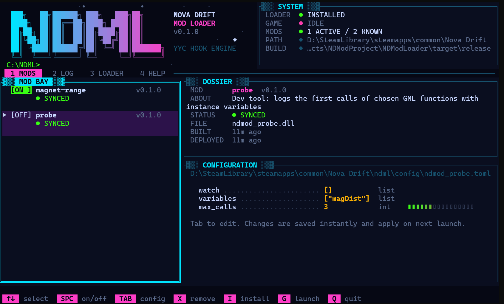

# NDML: Nova Drift Mod Loader



NDML loads native mods into [Nova Drift](https://store.steampowered.com/app/858210/Nova_Drift/).
It hooks the game's compiled GameMaker functions by name, so mods keep working across
game updates as long as the functions they use still exist.

* **Loader** (`version.dll`): placed in the game folder, loaded by Windows when the game
  starts, loads every enabled mod from `ndml/mods/`.
* **Manager** (`ndml.exe`): a terminal UI to install the loader, enable/disable mods,
  edit their settings, read the log and launch the game.
* **SDK** (`ndml-sdk`): the Rust crate mods are written with.

NDML never requires nor asks for internet access. Nothing is downloaded or uploaded, and all files it writes stay
in the game folder under `ndml/`.

> **Mods are native code.** A mod runs inside the game process with the same access
> to your computer as the game itself. Only install mods from sources you trust, and
> prefer mods that ship their source code.

## Included mods

| Mod | What it does |
|---|---|
| `magnet-range` | Multiplies the distance from which XP orbs and power-ups are pulled toward the ship. |
| `discord-presence` | Shows the current run (wave, level, score, run time, boss or hull) as Discord rich presence. Talks only to the local Discord app. |
| `probe` | Developer tool: logs calls to chosen GML functions and selected instance variables. Off by default. |

## Download

Prebuilt releases: [itch.io](https://catmancer0.itch.io/ndml-nova-drift-mod-loader) or
[GitHub Releases](https://github.com/Yume-13/NDML/releases). Each download contains the
full source code (`ndml-source.zip`).

1. Extract the zip anywhere (not into the game folder).
2. Run `ndml.exe`, press `I` to install the loader and mods into the game folder.
3. Press `G` to launch Nova Drift.

## Requirements

* Windows 10/11, 64-bit, Nova Drift (Steam).
* To build: [Rust](https://rustup.rs) (stable, MSVC toolchain, 1.85 or newer).

## Building and installing

```bat
ndml.cmd            :: builds everything (release) and opens the manager
ndml.cmd play       :: builds, installs the loader and mods, starts the game
```

Or by hand:

```bat
cargo build --release
target\release\ndml.exe install     :: copy version.dll and the mods into the game folder
target\release\ndml.exe launch      :: start Nova Drift through Steam
```

The game folder is found through the Steam library list. Set `NOVA_DRIFT_DIR` or pass
`--game-dir <path>` to override.

Other manager commands: `status`, `uninstall` (removes `version.dll`; settings, configs
and logs are kept), `snapshot N` (prints UI tab N as text).

Uninstalling by hand: delete `version.dll` from the game folder. The game then starts
unmodded. The `ndml/` folder can be deleted as well.

## Files in the game folder

```
Nova Drift/
├─ version.dll            the loader
└─ ndml/
   ├─ ndml.toml           loader settings (log level, console window, disabled mods)
   ├─ mods/ndmod_*.dll    installed mods
   ├─ config/<mod>.toml   per-mod settings, created with defaults on first use
   └─ logs/ndml.log       log of the last game session
```

Mod settings can be edited in the manager (Mods tab → Tab → arrow keys / Enter) or with
any text editor. Changes apply the next time the game starts.

## Documentation

* [docs/how-it-works.md](docs/how-it-works.md): how the loader starts, finds game
  functions and variables, and hooks them.
* [docs/mod-api.md](docs/mod-api.md): writing a mod with `ndml-sdk`.

## Repository layout

| Path | Contents |
|---|---|
| `crates/ndml-loader` | the loader (`version.dll`) |
| `crates/ndml-sdk` | SDK and the C ABI shared with the loader |
| `crates/ndml-common` | paths and settings shared by the loader and the manager |
| `crates/ndml-cli` | the manager (`ndml.exe`) |
| `mods/*` | the included mods |

Before submitting changes: `cargo fmt && cargo clippy --all-targets && cargo test`
(warning-free).

## License

MIT. See [LICENSE.md](LICENSE.md).

NDML is an unofficial, fan-made project. It is not affiliated with or endorsed by the
developers of Nova Drift, and contains no game code or assets.
